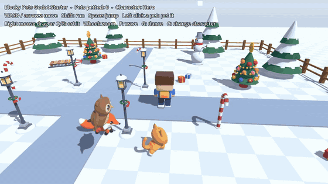
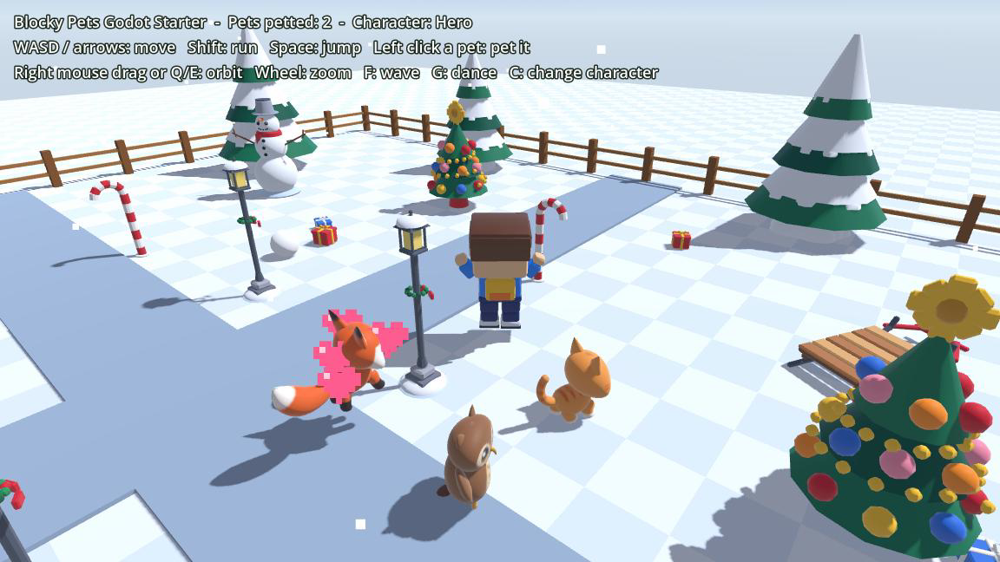

# Blocky Pets Godot Starter

A tiny third-person pet sandbox for **Godot 4**: walk a blocky character around a snowy garden while three animals follow you, pet them with a click, and swap between 8 characters. Small enough to read in ten minutes, and every model in it is **CC0**, so you can copy anything into your own game.



*(Recorded with `tools/record.sh`: that is the real game driven by a small autopilot script.)*



## What you get

- **Third-person character controller** (`CharacterBody3D`): camera-relative WASD movement, run, jump, push a snowball around, animation switching between `idle`, `walk`, `run`, `jump`, `fall`, plus `wave`, `dance` and `cheer` emotes.
- **8 rigged characters on one skeleton**: press `C` to swap models at runtime. Because they share the same 22-bone skeleton and clip names, the controller code never changes.
- **Following pets** (cat, fox, owl): each keeps its own spot behind you, walks or runs depending on the distance, plays `idle_alt` every few seconds and sits down when you stop. The owl hovers with its `fly` clip while it runs.
- **Click to pet**: a ray from the camera finds the animal under the mouse; it plays a happy clip, hops, and pixel hearts float up. The cursor turns into a hand when you hover one.
- **Orbit camera** with mouse drag, `Q`/`E` and zoom.
- A headless **smoke test** (`tools/smoke_test.gd`) that walks, runs, pets every animal and swaps all 8 characters.

Everything is plain, commented GDScript with typed variables: under 1000 lines in total including comments, no addons. The garden (lawn, fence, snow, hearts, snowball) is built in code, so the only external files are the CC0 `.glb` models.

## Run it

1. Install **Godot 4.x** from [godotengine.org](https://godotengine.org/download). It was written and tested with **Godot 4.7.2**; it only uses long-standing 4.x features, so 4.3 and newer should work too (I have not tried older versions).
2. Clone or download this repo.
3. In the Godot Project Manager choose **Import**, pick `project.godot`, open it and press **F5**.

The first import takes a few seconds while Godot converts the models. The project uses the *Compatibility* renderer, so it runs on almost any GPU and can be exported to the web.

### Controls

| Input | Action |
| --- | --- |
| `W A S D` / arrow keys | Move (relative to the camera) |
| `Shift` | Run |
| `Space` | Jump |
| Left click on an animal | Pet it |
| Right mouse drag, or `Q` / `E` | Orbit the camera |
| Mouse wheel | Zoom |
| `F` / `G` | Wave / dance |
| `C` | Next character |

Walking into the snowball kicks it.

## How it works

```
scenes/main.tscn      Main (main.gd): Garden, Player, Pets, CameraRig, HUD
scenes/player.tscn    CharacterBody3D + capsule; the model is loaded by player.gd
scenes/pet.tscn       CharacterBody3D + capsule; the model is loaded by pet.gd
scripts/player.gd     controller, animation state machine, character swapping
scripts/pet.gd        follow behaviour, per-species config table, petting reaction
scripts/camera_rig.gd orbit / zoom / smooth follow
scripts/garden.gd     sky, light, lawn, fence, snow, props table (edit PROPS to redecorate)
scripts/main.gd       wiring, mouse picking, HUD
scripts/anim_util.gd  helpers for imported .glb files (see below)
scripts/effects.gd    the pixel hearts, generated at runtime
scripts/input_setup.gd registers the input actions in code (change the key table to rebind)
scripts/autopilot.gd  scripted demo used only for recording the GIF (`--autopilot`)
tools/smoke_test.gd   headless test, tools/record.sh re-records the GIF
```

Three things that trip people up with imported `.glb` animals, and how this project handles them (all in `scripts/anim_util.gd`):

- **Clips do not loop after import.** `AnimUtil.set_looping()` switches `idle`, `walk`, `run` ... to `LOOP_LINEAR` once per model.
- **Each animal file contains two meshes** (`*_LOD0` detailed, `*_LOD1` mobile) that would draw on top of each other. `AnimUtil.setup_lod()` uses Godot's visibility ranges so LOD0 shows up close and LOD1 far away.
- **Pets have a hidden "one-shot" state.** `idle_alt` and `sit` play once and must not be restarted every frame; `pet.gd` tracks that with a small timer.

### Add your own animal

Drop a rigged `.glb` that has `idle`, `walk` and `run` clips into `assets/pets/`, add an entry to `Pet.SPECIES` in `scripts/pet.gd` (path, scale, speeds, which clip to play when petted) and one line to `PET_SLOTS` in `scripts/main.gd`.

### Tests

```bash
# imports the project and runs the main scene for a few seconds; should print no errors
godot --headless --path . --quit-after 300

# the smoke test: prints one "ok" line per check and "SMOKE TEST: PASSED"
godot --headless --fixed-fps 60 --path . --script res://tools/smoke_test.gd
```

## Assets and licences

- **Code** (`scripts/`, `scenes/`, `tools/`, `project.godot`): MIT, see [LICENSE](LICENSE).
- **3D models, animations, textures** in `assets/`: **CC0 1.0 (public domain)**, see [assets/LICENSE-ASSETS.txt](assets/LICENSE-ASSETS.txt). Use them for anything, commercial included, no credit needed. They are the free samples from the packs below, nothing from the paid packs is included.

**Honest note:** I (Vuena) made these assets myself with my own procedural Blender Python code, which I wrote with AI help. The meshes and textures are not AI-generated. This demo's code was also written with AI assistance and then tested by running it.

## Want more? Full packs:

If this style fits your game, the full versions are on itch.io:

- **[Cute Pets & Wildlife (Blocky Pets & Wildlife page)](https://vuena.itch.io/blocky-pets-wildlife)**: 36 rigged animals, 12 animations each (the cat, fox and owl here are free samples of it)
- **[48 Blocky Characters](https://vuena.itch.io/blocky-characters-48)**: 48 rigged characters on the same skeleton as the 8 here, 30 animations
- **[Blocky Character Creator](https://vuena.itch.io/blocky-character-creator)**: a mix-and-match kit (hair, hats, outfits, faces) for building your own rigged blocky characters

More free CC0 stuff: the **[Vuena Free Mega Starter](https://vuena.itch.io/vuena-free-mega-starter)** has 68 free assets (all the models in this repo came from it) with no strings attached.

If you make something with this, I would love to see it.
